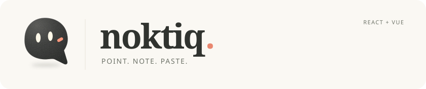
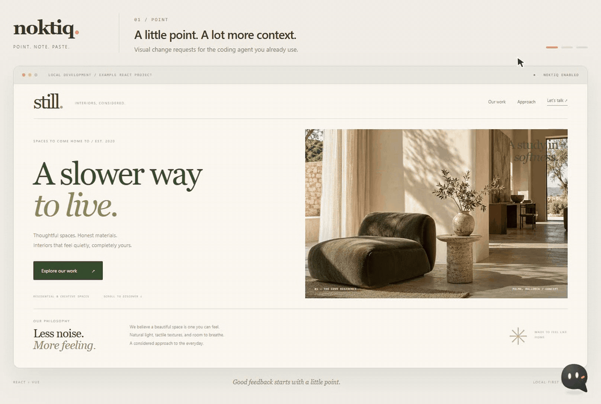

<p align="center">
  
</p>

<p align="center"><strong>Show your agent which part needs to change.</strong></p>

<p align="center">
  <a href="#see-it-in-action">Watch it work</a> ·
  <a href="#quickstart">Quickstart</a> ·
  <a href="#usage">React &amp; Vue</a> ·
  <a href="#development-and-production">Before deploying</a> ·
  <a href="#output">Output</a> ·
  <a href="#compatibility">Compatibility</a> ·
  <a href="docs/guide.tr.md">Detailed guide · Türkçe</a>
</p>

Click the UI. Describe the change. Give your agent a request that carries its location.

Noktiq is a visual feedback tool for **React and Vue**. Select a button, a heading or several elements; it collects the source location when available, the element context and your note in one copyable request.

Paste it into **Claude Code, Codex or your existing coding agent**. Noktiq gathers the context; your agent edits the code. No AI account or API key is needed by Noktiq.

**Built to reduce back-and-forth and unnecessary token use when explaining visual changes.**

## See it in action

[](docs/assets/noktiq-demo.mp4)

<p align="center">
  <a href="docs/assets/noktiq-demo.mp4">Watch the full-resolution MP4</a> ·
  <a href="docs/assets/noktiq-demo-poster.png">Static preview</a> ·
  <a href="docs/walkthrough-request.md">Read the captured request</a>
</p>

Recorded with the actual Noktiq toolbar on an example interior-studio website. Watch Nok move, two elements become notes, and the compact list open before copying. The final panel previews an excerpt of the real clipboard output; it is not a direct agent connection. The toolbar, example website and chapter captions are in English.

## How it works

1. **Point.** Click Nok to enter selection mode, then click what you want to change.
2. **Note.** Describe the change and save. A numbered pin stays on the element.
3. **Paste.** Copy one request or all notes into your coding agent.

Click Nok again to leave selection mode. Open the notes list when you need it; your notes stay local to the browser.

Hold and drag Nok to move it. The menu and notes panel adapt to the available space. Note actions are available as labeled icons; expand **Details** to inspect a selector or rebind a target. Opening and closing transitions respect reduced-motion preferences.

## Why Noktiq

You can see the change you want. Getting a coding agent to see the same thing can take much longer.

A button needs a little more space. A heading feels too large. You describe its position, try to distinguish it from three similar elements, and help the agent search for the right component. If it finds a different one, you explain again. A small visual change becomes a conversation about where to make it, with more prompts, code searches and tokens along the way.

Noktiq grew out of that frustration. The idea is simple: point at what you already see, describe the change there, and carry the element's context into your existing coding agent. Source locations, when available, help connect the page to the code. Selectors and instance identifiers help distinguish repeated elements.

**Less time explaining where. More context for making the change.**

- **Source before guesswork.** Include the file, line and column when the source integration can identify them. Keep selectors and instance identifiers alongside them.
- **Fewer clarification rounds.** Give your agent a precise target and request together, with the aim of reducing repeated explanations, unnecessary searches and avoidable token use.
- **React and Vue, one workflow.** Use the same selection and handoff flow across both frameworks, including tested Next.js and Nuxt setups.
- **Notes that stay attached.** Numbered pins, live target status and rebinding help you return to feedback as the page changes.
- **A little character.** Nok reacts to your selection, saved notes and successful copying. Motion respects your reduced-motion preference.

**About token savings:** Noktiq is designed to help reduce the total tokens spent locating and clarifying a visual change. Its structured request may be longer than a short text prompt; the potential saving comes from fewer searches and correction rounds across the whole task. Actual usage depends on the agent, model, project and request. We have not published a token-savings benchmark or percentage, and savings are not guaranteed.

## Quickstart

Install [Noktiq from npm](https://www.npmjs.com/package/noktiq) in your application. Licensed under [PolyForm Shield 1.0.0](LICENSE).

```sh
npm install -D noktiq
```

Then add the React or Vue component and the source plugin below. Keep your application's existing entry point, framework plugin and configuration. Installing the package alone does not display the mascot.

## Usage

### React + Vite

```tsx
import { Noktiq } from 'noktiq/react';

export default function App() {
  return (
    <>
      {/* Your application */}
      <Noktiq enabled={import.meta.env.DEV} />
    </>
  );
}
```

For source file and line information, add the Vite plugin before your React plugin:

```ts
// vite.config.ts
import { defineConfig } from 'vite';
import react from '@vitejs/plugin-react';
import { noktiq } from 'noktiq/vite';

export default defineConfig({
  plugins: [noktiq(), react()],
});
```

### Vue + Vite

```vue
<script setup>
import { Noktiq } from 'noktiq/vue';
const isDev = import.meta.env.DEV;
</script>

<template>
  <!-- Your application -->
  <Noktiq :enabled="isDev" />
</template>
```

```ts
// vite.config.ts
import { defineConfig } from 'vite';
import vue from '@vitejs/plugin-vue';
import { noktiq } from 'noktiq/vite';

export default defineConfig({
  plugins: [noktiq(), vue()],
});
```

Start your application's development server, usually with `npm run dev`, and open its URL. Click Nok to start selecting. Restart the development server after changing its plugin configuration.

### Next.js and Nuxt

<details>
<summary>Next.js 14–16: App Router or Pages Router</summary>

Wrap your existing configuration to enable development source locations:

```js
// next.config.mjs
import { withNoktiq } from 'noktiq/next';
export default withNoktiq({ /* Your existing Next.js configuration */ });
```

Create a client component:

```tsx
// app/dev-tools.tsx (or your components directory)
'use client';
import { Noktiq } from 'noktiq/react';

export default function DevTools() {
  return <Noktiq enabled={process.env.NODE_ENV === 'development'} />;
}
```

Render `<DevTools />` once from your root layout in App Router, or from `_app` in Pages Router. Preserve your existing page content and providers. Restart `next dev` after editing the configuration.

</details>

<details>
<summary>Nuxt 3–4</summary>

Add the plugin alongside your existing configuration:

```ts
// nuxt.config.ts
import { noktiq } from 'noktiq/vite';
import { fileURLToPath } from 'node:url';

export default defineNuxtConfig({
  vite: { plugins: [noktiq({ root: fileURLToPath(new URL('.', import.meta.url)) })] },
});
```

Add the component once in `app.vue` (Nuxt 3) or `app/app.vue` (Nuxt 4), keeping your existing application content:

```vue
<script setup>
import { Noktiq } from 'noktiq/vue';
const isDev = import.meta.dev;
</script>

<template>
  <!-- Your existing application content -->
  <ClientOnly><Noktiq :enabled="isDev" /></ClientOnly>
</template>
```

No separate Nuxt module is needed. Restart the development server after changing the plugin configuration.

</details>

## Development and production

**Keep the development condition shown in the examples. You do not need to remove the component manually before deploying.**

| How the application is running | With the documented development condition |
| --- | --- |
| Development server, such as `npm run dev` | Nok appears and you can select elements and write notes. |
| Production build and local preview | Nok stays hidden, even when the preview URL is `localhost`. |
| Deployed production build | Visitors do not see Nok, its menu or annotation pins. |

Use `import.meta.env.DEV` in Vite, `process.env.NODE_ENV === 'development'` in Next.js, and `import.meta.dev` in Nuxt. `enabled` defaults to `false`; omitting it keeps the toolbar disabled in every environment. Hardcoding `enabled={true}` or `:enabled="true"` mounts the toolbar in production too. Installing with `-D` does not replace the runtime development condition.

The source plugin also skips production builds. Hiding the toolbar does not promise that all library JavaScript has been removed from the production bundle.

Without a source plugin, selection, notes and copying still work with the DOM information available. See the [detailed guide](docs/guide.tr.md) for **Next.js**, **Nuxt**, **Webpack**, editor links and configuration options.

## Features

<details>
<summary>Explore the selection, context and workflow tools</summary>

| Feature | What it helps you do |
| --- | --- |
| Element, text, multi and area selection | Point to one control, a word, or several elements in the same request. |
| Source-first context | Include the original file, line and column when available, alongside selectors and React/Vue component context. |
| Numbered pins | Return to saved feedback, inspect its target status, or rebind the note after a page change. |
| Parent selection | Move from an SVG detail to its button or card without rewriting the note. |
| Flexible copying | Copy one note or all notes; choose output detail or source/class-only formats. |
| Styles and editor links | Inspect computed CSS and request that a detected source location open in your editor. |
| Modals and embedded content | Annotate supported dialogs, menus, open Shadow DOM and same-origin iframe content. |
| Route-aware notes | Keep feedback with its page and preserve unfinished drafts across internal navigation. |
| Motion controls | Pause supported page motion, hide pins, and reposition the toolbar. |
| Nok | An animated mascot that responds to selection, saving and successful copying, with reduced-motion support. |

</details>

### Settings and keyboard controls

Open **Tools and settings** (`…`) to choose element, text, multiple-element or area selection; output detail; copy format; pin visibility; motion controls; and keyboard shortcuts. Open **Notes** to review, edit, copy or delete individual requests. **Copy all notes** exports the current page's notes; **Clear all** removes them from browser storage too.

With Nok open and focus outside text fields, use **E/T/M/A** for selection modes, **H** for pins, **P** for page motion and **C** to copy. **Enter** annotates a multi-selection and **Esc** closes the toolbar while preserving an unfinished ordinary draft. **Ctrl/Cmd+Shift+F** toggles Nok outside text fields. In the note editor, **Alt+↑/↓** moves to the parent or previous element. Focus Nok and use **Shift+arrow keys** to move it with the keyboard.

The React component and Vue component accept these options:

- `enabled` (default `false`): mount the toolbar; pass your development condition.
- `outputDetail` (default `standard`): choose `compact`, `standard` or `detailed` context.
- `copyFormat` (default `markdown`): copy Markdown notes, `source` paths or CSS `classes`.
- `useHashLocation` (default `true`): separate hash-router pages such as `#/settings`.
- `enableKeyboardShortcuts` (default `true`): enable shortcuts; Escape remains available.
- `openInEditor` (unset): provide a callback for opening detected file/line locations.
- `portalContainer` (automatic): choose an overlay container for custom placement.

## Output

The handoff includes what you selected, where it lives and what you want changed. Here is an excerpt from the recorded walkthrough:

```text
## 1. button
Source: main.tsx:25:15
Source kind: selected element definition
Selector: #demo-cta
Visible text: "Explore our work ↗"
Requested change: "Give this button a 12px radius and more horizontal padding."
```

The [full captured request](docs/walkthrough-request.md) also includes the page, viewport, component context and second note. A source location identifies the code that creates an element; selectors and row identifiers distinguish repeated instances.

When an exact source line is unavailable, Noktiq labels ancestor or component context rather than presenting it as the selected element's definition. Your agent should verify the captured location before editing.

## Compatibility

These are tested versions and scenarios, rather than a guarantee for every component or version combination.

| Layer | Verified coverage |
| --- | --- |
| Frameworks | React 18/19; Vue 3.4/3.5 |
| App frameworks | Next.js 14/15/16 with App and Pages Routers; Nuxt 3/4 |
| Build tools | Vite 6/7/8, Webpack 5 and Next.js Turbopack |
| React UI | shadcn/ui Radix and Base UI registry dialogs/menus; MUI 7/9 dialog/menu fixtures |
| Vue UI | PrimeVue 4/5 and Vuetify 3/4 dialog/select fixtures |
| Routing | React Router 7, TanStack Router and Vue Router 4 |
| Virtualized data | TanStack Table/Virtual, Vue Virtual and AG Grid fixtures with stable row IDs |
| Browser engines | Chrome, Firefox and WebKit; physical Safari/iPhone testing is not included |

Exact versions and captured outputs: [framework matrix](reports/compatibility.md), [current UI ecosystem](reports/ecosystem-current.md), [older UI majors](reports/ecosystem-legacy.md), [browser regression](reports/validation.md).

## Local development

Use a Node version compatible with the installed Vite toolchain; this repository uses Vite 8. See the [developer guide](docs/guide.tr.md) for runtime requirements and test commands.

```sh
npm install
npm run build
npm run dev:react
```

Open the [React demo](http://127.0.0.1:5173). Run `npm run dev:vue` in another terminal for the [Vue demo](http://127.0.0.1:5174). Each demo links to selection and source test screens.

Examples consume the built package. Run `npm run build` again after changing library source.

The walkthrough can be regenerated with `npm run record:readme` after building the library. It requires Chrome and a full FFmpeg installation. See [media production notes](docs/media.md). Demo recordings stay out of the npm archive.

## Privacy and boundaries

- No AI account, API key or direct agent connection is required. Noktiq does not send notes over the network; you choose what to copy into your agent.
- Notes use browser `localStorage`, separated by origin, path and, by default, hash route. Writes are coordinated between tabs using an IndexedDB transaction; notes remain in localStorage. If storage or write coordination is blocked, a warning appears and notes remain in memory during internal navigation; a full reload loses memory-only data.
- Mark sensitive regions with `data-noktiq-private`. Visible page text can appear in requests; inspect the output before sharing it.
- Closed Shadow DOM and cross-origin iframes are inaccessible. Individual objects inside a canvas or 3D scene cannot be selected.
- Virtualized rows need stable record IDs. If a target becomes ambiguous or disappears, its note remains available without a misleading pin.

Installation details, keyboard controls, source fallbacks, programmatic options and project structure are in the [developer guide](docs/guide.tr.md).

## Frequently asked questions

**Why is the mascot missing?** Check that the component is rendered once, its `enabled` condition is true, and you are running the development server rather than a production preview. Installing the package or configuring the source plugin alone does not mount the toolbar.

**Why is a file or line missing?** Add the source plugin to the application that renders the selected content, then restart that development server. Exact locations depend on the source format and build integration. When unavailable, Noktiq includes known component or ancestor context and DOM identifiers; it does not invent a line number. A captured source location points to rendering code, not necessarily the CSS rule or event handler you want to edit.

**Does Noktiq change my code or send feedback to an AI?** You write notes and copy the result. Your existing coding agent performs the edit. Noktiq requires no AI API key or subscription and does not automatically submit your notes.

**Where are my notes?** Notes belong to the current page and browser origin. Tabs synchronize saved changes. Notes from `localhost:3000` do not automatically appear on another port or a deployed domain. If storage is unavailable, copy the memory-only notes before reloading. Another tab's deletion is respected, with unfinished text preserved for copying.

**What if clipboard access is blocked?** Noktiq opens a selectable output preview. Use Ctrl/Cmd+C to copy it manually.

**How do I remove Noktiq?** Remove its component/import and source-plugin configuration, then run `npm uninstall noktiq`. Remove saved notes with **Clear all** before uninstalling if you want to clear that page's stored feedback.

## License

Noktiq is **source-available under the [PolyForm Shield License 1.0.0](LICENSE)**. You may use, modify and distribute it for purposes permitted by that license. Providing competing products or services is restricted, including free competing offerings, subject to the full license terms and exceptions.

This is a brief summary; the complete [LICENSE](LICENSE) governs. Third-party dependencies retain their own licenses.

Copyright (c) 2026 Duran Gezer.

## Contributing and security

Read the [contribution guide](CONTRIBUTING.md) before opening a pull request. Report security issues through the private process in [SECURITY.md](SECURITY.md); keep sensitive details out of public issues.

Maintainers can run `npm run check:release` before sharing the repository. See the [publication checklist](docs/publishing.md) for local checks and the GitHub settings to configure after creating the repository.
